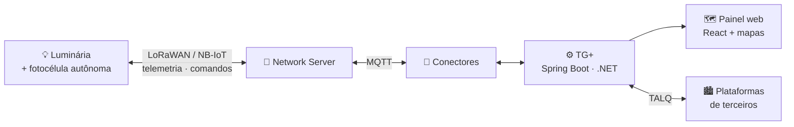

<h1 align="center">👋 Prazer, sou Levi Nunes</h1>
<p align="center"><b>Full Stack Developer · IoT · Iluminação Pública Inteligente</b></p>
<p align="center"><i>A fotocélula cuida de acender a luz. Eu cuido de saber se ela acendeu.</i></p>

---

```text
$ whoami
levi.sousa  →  full stack dev @ NEPEN

$ uptime
desde 2024 · ~2.700 commits em produção · milhares de luminárias conectadas

$ cat /etc/stack
frontend   React · TypeScript · Vite · Tailwind · Leaflet
backend    Java · Spring Boot · .NET / C#
dados      PostgreSQL + PostGIS · Redis · Flyway
iot        MQTT · LoRaWAN (ChirpStack, Everynet, Netmore) · NB-IoT · TALQ
infra      Docker · GeoServer
```

## 🌃 O que eu construo



- **TG+**: plataforma de gestão de iluminação pública. Monitora o parque em tempo real, com inventário georreferenciado e relatórios, e envia comandos para ajustar ou controlar as luminárias quando preciso.
- **Integração TALQ**: implementação do padrão internacional de interoperabilidade para Smart Cities (bootstrap, data collect, control, group management).
- **Conectores IoT**: pontes MQTT entre network servers LoRaWAN/NB-IoT e o núcleo da plataforma.
- **Painel de firmware**: reconstruí o frontend de atualização de firmware com uma stack moderna (React + Vite + TypeScript) e uma UI pensada para o cliente.

## 🧰 Ferramentas

<p>
  
</p>

## 📈 Em números

| | |
|---|---|
| 🖥️ Commits no frontend do TG+ | **1.700+** |
| ☕ Commits no backend do TG+ | **650+** |
| 🔌 Protocolos/redes integrados | **LoRaWAN · NB-IoT · MQTT · TALQ** |
| 🌙 Lâmpadas apagadas que passaram despercebidas | **0** (até onde eu sei) |

## 📫 Contato

[](https://www.linkedin.com/in/levinsousa)
[](mailto:llevinsousa@nepen.org.br)

<p align="center"><sub>⚡ Se a luz da sua rua queimou, alguém já ficou sabendo. Talvez por um commit meu.</sub></p>
